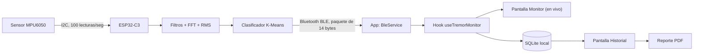

# 📘 Documentación del Proyecto
## Sistema Vestible de Detección de Temblor en Parkinson

> Esta guía está escrita para **cualquier persona**, aunque nunca haya programado.
> Explica qué es el proyecto, qué hay que instalar, cómo ponerlo a funcionar
> paso a paso y, al final, **cómo está construido y por qué se tomó cada decisión**.

---

## 📑 Índice

1. [¿Qué es este proyecto?](#1-qué-es-este-proyecto)
2. [Las piezas del sistema](#2-las-piezas-del-sistema)
3. [Qué necesitas antes de empezar](#3-qué-necesitas-antes-de-empezar)
4. [Instalación del software (paso a paso)](#4-instalación-del-software-paso-a-paso)
5. [Levantar la pulsera (firmware)](#5-levantar-la-pulsera-firmware)
6. [Levantar la aplicación móvil](#6-levantar-la-aplicación-móvil)
7. [Problemas comunes y soluciones](#7-problemas-comunes-y-soluciones)
8. [Cómo está construido el proyecto](#8-cómo-está-construido-el-proyecto)
9. [Tecnologías usadas y por qué](#9-tecnologías-usadas-y-por-qué)
10. [El proceso: cómo viaja un dato](#10-el-proceso-cómo-viaja-un-dato)
11. [Por qué el código se comporta así](#11-por-qué-el-código-se-comporta-así)
12. [La interfaz (UI)](#12-la-interfaz-ui)
13. [Limitaciones y siguientes pasos](#13-limitaciones-y-siguientes-pasos)
14. [Glosario](#14-glosario)

---

## 1. ¿Qué es este proyecto?

Es un sistema formado por **una pulsera** y **una aplicación para el celular** que
sirve para **detectar el temblor en reposo** típico de la enfermedad de Parkinson y
clasificarlo en tres niveles:

| Nivel | Color en la app | Significado |
|---|---|---|
| 🟢 **Leve** | Verde | Temblor bajo o inexistente |
| 🟠 **Moderado** | Naranja | Temblor notable |
| 🔴 **Severo** | Rojo | Temblor fuerte |

**¿Cómo funciona en pocas palabras?**

1. La pulsera tiene un sensor que "siente" los movimientos de la mano.
2. Un pequeño chip dentro de la pulsera **analiza esos movimientos ahí mismo** y
   decide si hay temblor y qué tan fuerte es.
3. Envía el resultado al celular por **Bluetooth**.
4. La app muestra el temblor **en vivo**, lo **guarda** y permite ver el
   **historial** por día, semana o mes, e incluso **exportar un reporte PDF** para
   el médico.

> 💡 **No necesita internet ni servidores.** Todo se procesa en la pulsera y se
> guarda en el propio celular. Esto protege la privacidad del paciente.

---

## 2. Las piezas del sistema

```
 ┌────────────────────┐   Bluetooth   ┌─────────────────────┐
 │      PULSERA       │  ───────────► │    APP DEL CELULAR  │
 │  Sensor MPU6050    │               │  Muestra en vivo    │
 │  Chip ESP32-C3     │               │  Guarda historial   │
 │  (analiza temblor) │               │  Genera reportes    │
 └────────────────────┘               └─────────────────────┘
```

| Carpeta | Qué contiene |
|---|---|
| `firmware_arduino/TremorWearable/` | El "programa" que vive dentro de la pulsera |
| `app/` | La aplicación móvil (Android) |
| `README.md` | Documentación técnica para desarrolladores |
| `DOCUMENTACION.md` | Este documento |

### Hardware (lo físico)

- **Seeed XIAO ESP32-C3**: una placa diminuta (del tamaño de una uña) con
  procesador y Bluetooth. Es el "cerebro" de la pulsera.
- **MPU6050**: un sensor de movimiento (acelerómetro) — el mismo tipo de sensor
  que usa tu celular para saber si lo giraste.
- Cable **USB-C** para programar la placa.
- Un **celular Android** (o un emulador en la computadora).

### Conexión del sensor a la placa

| MPU6050 | XIAO ESP32-C3 |
|---|---|
| VCC | 3V3 |
| GND | GND |
| SDA | D4 (GPIO6) |
| SCL | D5 (GPIO7) |
| AD0 | GND |

---

## 3. Qué necesitas antes de empezar

| Programa | ¿Para qué sirve? | ¿Para qué parte? |
|---|---|---|
| **Node.js** (v22.11 o más nueva) | Ejecuta las herramientas de JavaScript que construyen la app | App |
| **pnpm** | Descarga las "piezas" (librerías) que usa la app | App |
| **Git** (opcional) | Descargar/actualizar el proyecto | Ambos |
| **JDK 17** (Java) | Android necesita Java para compilar la app | App |
| **Android Studio** | Trae las herramientas de Android y el emulador | App |
| **Arduino IDE 2.x** | Programa para cargar el código en la pulsera | Pulsera |

> ⏱️ La primera instalación puede tomar entre **1 y 2 horas** (por las descargas).
> Después, levantar el proyecto toma un par de minutos.

---

## 4. Instalación del software (paso a paso)

> Las instrucciones son para **Windows**. Cada vez que se diga "abre una
> terminal", significa: presiona la tecla **Windows**, escribe **PowerShell** y
> ábrelo. Es una ventana donde se escriben comandos.

### 4.1 Instalar Node.js

**¿Qué es?** Node.js permite ejecutar programas escritos en JavaScript en tu
computadora. La app usa muchas herramientas que funcionan con Node.

1. Entra a **https://nodejs.org**
2. Descarga la versión **LTS** (la recomendada). Debe ser **22.11 o superior**.
3. Abre el instalador y da **Siguiente → Siguiente → Instalar** (deja todo por defecto).
   - ✅ Si aparece la casilla *"Automatically install the necessary tools"*, márcala.
4. **Cierra y vuelve a abrir** la terminal y verifica:

```powershell
node -v
npm -v
```

Si ves algo como `v22.12.0` y `10.9.0`, ¡quedó instalado! 🎉

### 4.2 Instalar pnpm

**¿Qué es?** Un "gestor de paquetes": descarga automáticamente todas las
librerías que la app necesita. Es más rápido y ocupa menos espacio que `npm`.

```powershell
npm install -g pnpm
pnpm -v
```

### 4.3 Instalar Java (JDK 17)

**¿Por qué?** Las apps Android se compilan con herramientas de Java.

1. Ve a **https://adoptium.net** y descarga **Temurin 17 (LTS)** para Windows (.msi).
2. Durante la instalación, activa las opciones **"Set JAVA_HOME variable"** y
   **"Add to PATH"**.
3. Verifica:

```powershell
java -version
```

### 4.4 Instalar Android Studio

**¿Qué es?** El programa oficial de Google para Android. Lo necesitamos por el
**SDK** (las herramientas para construir la app) y por el **emulador** (un
celular virtual dentro de tu computadora).

1. Descarga desde **https://developer.android.com/studio** e instala con las opciones por defecto.
2. Ábrelo y deja que termine el asistente inicial (descarga el SDK).
3. Ve a **More Actions → SDK Manager** y verifica que estén instalados:
   - Pestaña *SDK Platforms*: la versión de Android más reciente.
   - Pestaña *SDK Tools*: **Android SDK Build-Tools**, **Android SDK Platform-Tools**,
     **NDK (Side by side)** y **CMake** (la app usa módulos nativos que los requieren).
4. **Configurar variables de entorno** (para que Windows sepa dónde está Android):
   - Presiona Windows, escribe **"variables de entorno"** → *Editar las variables de entorno del sistema*.
   - Clic en **Variables de entorno…** → en *Variables de usuario* → **Nueva**:
     - Nombre: `ANDROID_HOME`
     - Valor: `C:\Users\TU_USUARIO\AppData\Local\Android\Sdk`
   - Edita la variable **Path** y agrega:
     - `%ANDROID_HOME%\platform-tools`
     - `%ANDROID_HOME%\emulator`
5. Cierra y abre la terminal, y verifica:

```powershell
adb --version
```

#### Crear un emulador (si no usarás celular físico)

En Android Studio: **More Actions → Virtual Device Manager → Create Device**, elige
un teléfono (ej. Pixel), descarga una imagen del sistema y dale **Finish**.

> ⚠️ **Importante:** el emulador **no tiene Bluetooth real**, así que no podrá
> conectarse a la pulsera. Sirve para ver la interfaz y los **datos de demostración**.
> Para usar la pulsera de verdad, usa un **celular físico**.

#### Usar un celular físico Android

1. En el celular: **Ajustes → Acerca del teléfono** → toca **7 veces** "Número de compilación".
2. Entra a **Opciones de desarrollador** y activa **Depuración USB**.
3. Conecta el celular por USB y acepta el mensaje "¿Permitir depuración?".
4. Verifica en la terminal:

```powershell
adb devices
```

Debe aparecer tu dispositivo con la palabra `device`.

### 4.5 Instalar Arduino IDE

1. Descarga **Arduino IDE 2.x** desde **https://www.arduino.cc/en/software** e instálalo.
2. Lo configuraremos en la siguiente sección.

---

## 5. Levantar la pulsera (firmware)

**"Firmware"** es el programa que vive dentro de un aparato electrónico.

1. **Agregar soporte para la placa ESP32**
   - Arduino IDE → **Archivo → Preferencias**.
   - En *"URLs adicionales de gestor de placas"* pega:
     `https://espressif.github.io/arduino-esp32/package_esp32_index.json`
   - **Herramientas → Placa → Gestor de placas**, busca **esp32** (de Espressif
     Systems) e instala la versión **3.x**.

2. **Seleccionar la placa**: Herramientas → Placa → esp32 → **XIAO_ESP32C3**.
   *Si no aparece, usa **ESP32C3 Dev Module***; funciona igual.

3. **Instalar librerías**: Herramientas → **Administrar bibliotecas**, busca e instala:
   - `arduinoFFT` (de Enrique Condes) — versión 2.x
   - `NimBLE-Arduino` (de h2zero) — versión 2.x

4. **Abrir el proyecto**: Archivo → Abrir →
   `firmware_arduino/TremorWearable/TremorWearable.ino`
   (los demás archivos se abren solos en pestañas).

5. **Conectar la placa** por USB-C y elegir el puerto en **Herramientas → Puerto**.

6. Presiona **✓ (Verificar)** y luego **→ (Subir)**.
   > Si falla al subir: mantén presionado el botón **BOOT** de la placa mientras la
   > conectas, suéltalo e intenta de nuevo.

7. **Comprobar que funciona**: Herramientas → **Monitor Serie**, velocidad **115200**.
   Deberías ver líneas como:
   ```
   RMS=0.0123 PSD_max=0.0004 severity=Leve
   ```

✅ La pulsera ya está transmitiendo por Bluetooth.

---

## 6. Levantar la aplicación móvil

### 6.1 Descargar las librerías (solo la primera vez)

Abre una terminal **dentro de la carpeta `app`** del proyecto:

```powershell
cd C:\ruta\al\proyecto\rita\app
pnpm install
```

Esto crea una carpeta `node_modules` con todas las piezas que usa la app. Puede tardar varios minutos.

### 6.2 Ejecutar la app

1. Ten listo el **emulador abierto** o el **celular conectado** (`adb devices`).
2. En la terminal, dentro de `app`:

```powershell
pnpm android
```

¿Qué pasa al ejecutar esto?
- Se abre una ventana extra llamada **Metro**: es el "servidor" que le entrega el
  código JavaScript a la app. **No la cierres** mientras uses la app.
- Se compila la app Android (la **primera vez tarda 5–15 minutos**; después es mucho más rápido).
- La app se instala y se abre sola en el celular/emulador.

> Si quieres arrancar Metro por separado: `pnpm start` en una terminal y
> `pnpm android` en otra.

### 6.3 Usar la app

1. Activa el **Bluetooth** y la **ubicación** del celular.
2. En la pestaña **Monitor**, toca **Conectar**. Acepta los permisos que pida.
3. Verás la severidad en tiempo real y una gráfica que se mueve.
4. En **Historial** puedes elegir día/semana/mes, ver gráficas, episodios y
   **exportar a PDF**.
5. Sin pulsera, puedes cargar **datos de demostración** (registros reales de un
   paciente del estudio ALAMEDA) para ver cómo luce el historial.

### Resumen rápido (cuando ya está todo instalado)

```powershell
cd rita\app
pnpm install      # solo si cambiaron dependencias
pnpm android
```

---

## 7. Problemas comunes y soluciones

| Problema | Solución |
|---|---|
| `node no se reconoce como comando` | Reinstala Node.js y **reabre la terminal** |
| `SDK location not found` | Revisa la variable `ANDROID_HOME`, o crea `app/android/local.properties` con `sdk.dir=C:\\Users\\TU_USUARIO\\AppData\\Local\\Android\\Sdk` |
| `No connected devices` | Abre el emulador o revisa `adb devices` y la depuración USB |
| Error de versión de Java | Asegúrate de tener **JDK 17** y que `JAVA_HOME` apunte a él |
| La app abre en blanco / "Unable to load script" | Metro no está corriendo: ejecuta `pnpm start` |
| Errores raros tras actualizar | Borra `node_modules`, vuelve a `pnpm install`; y en `app/android` ejecuta `.\gradlew clean` |
| La app no encuentra la pulsera | Verifica Bluetooth + ubicación activados, permisos concedidos y que la pulsera esté encendida (Monitor Serie) |
| Arduino no muestra el puerto | Prueba otro cable USB-C (algunos solo cargan) y el truco del botón **BOOT** |

---

## 8. Cómo está construido el proyecto

### Estructura de carpetas (lo importante)

```
rita/
├── firmware_arduino/TremorWearable/   ← Código de la pulsera (C++)
│   ├── TremorWearable.ino             ← Programa principal
│   ├── mpu6050.*                      ← Lee el sensor
│   ├── butterworth_filter.h           ← Filtros de señal
│   ├── dsp_features.*                 ← Cálculo de RMS, FFT, PSD
│   ├── severity_classifier.*          ← Decide Leve/Moderado/Severo
│   ├── ble_service.*                  ← Envía por Bluetooth
│   └── ble_protocol.h                 ← "Idioma" compartido con la app
│
└── app/                               ← App móvil (React Native + TypeScript)
    ├── App.tsx                        ← Punto de entrada; pestañas
    ├── tailwind.config.js             ← Paleta de colores de la UI
    └── src/
        ├── ble/        ← Conexión Bluetooth y lectura de paquetes
        ├── db/         ← Base de datos local SQLite
        ├── hooks/      ← useTremorMonitor: une Bluetooth + guardado
        ├── lib/        ← Lógica: periodos, rangos, PDF, demo, caché
        ├── components/ ← Piezas visuales reutilizables (gráficas, tarjetas…)
        ├── screens/    ← Pantallas: Monitor (Home) e Historial
        ├── assets/     ← Logo, imágenes y datos demo
        └── types/      ← Definiciones de tipos de datos
```

### Arquitectura general



---

## 9. Tecnologías usadas y por qué

### En la pulsera

| Tecnología | ¿Qué es? | ¿Por qué se eligió? |
|---|---|---|
| **XIAO ESP32-C3** | Microcontrolador con Bluetooth | Muy pequeño (cabe en una pulsera), barato, bajo consumo y Bluetooth integrado |
| **MPU6050** | Acelerómetro/giroscopio | Económico, preciso y muy documentado |
| **Arduino IDE / C++** | Entorno y lenguaje de programación | Fácil de instalar y usar; enorme comunidad |
| **arduinoFFT** | Librería de análisis de frecuencias | Permite saber "a qué ritmo" tiembla la mano |
| **NimBLE-Arduino** | Librería Bluetooth | Usa mucha menos memoria que la librería Bluetooth estándar |

### En la app

| Tecnología | ¿Qué es? | ¿Por qué se eligió? |
|---|---|---|
| **React Native 0.87 (CLI)** | Framework para apps móviles con JavaScript | Un solo código sirve para Android e iOS; gran comunidad; se integra con módulos nativos como Bluetooth |
| **CLI puro (sin Expo Go)** | Forma de crear el proyecto | Expo Go **no permite** librerías nativas como Bluetooth BLE o SQLite rápida; el CLI da control total |
| **TypeScript** | JavaScript con "tipos" | Detecta errores antes de ejecutar (ej. confundir un número con un texto) |
| **pnpm** | Gestor de paquetes | Más rápido y ahorra espacio en disco |
| **react-native-ble-plx** | Librería Bluetooth Low Energy | La más madura y mantenida para BLE en React Native |
| **op-sqlite** | Base de datos local | Muy rápida; se descartó `react-native-sqlite-storage` por estar abandonada e incompatible con Android moderno |
| **TanStack React Query** | Caché de consultas | Evita volver a consultar la base de datos si ya se vieron esos datos |
| **NativeWind (Tailwind)** | Estilos por clases | Permite diseñar rápido y con una paleta de colores consistente |
| **react-native-gifted-charts + svg** | Gráficas | Gráficas bonitas y fluidas en el celular |
| **react-native-share** | Compartir archivos | Para enviar el PDF por WhatsApp, correo, etc. |

### ¿Por qué React Native y no otra opción?

- **vs. app nativa (Kotlin/Swift):** habría que escribir dos apps distintas para
  Android e iOS. Con React Native es **un solo código**.
- **vs. Flutter:** también es buena opción, pero React Native usa
  JavaScript/TypeScript, un lenguaje más conocido, y tiene librerías BLE y SQLite
  muy probadas.
- **vs. app web:** los navegadores tienen soporte de Bluetooth limitado y no
  pueden guardar grandes cantidades de datos de forma confiable.

### ¿Por qué sin servidor (backend)?

- **Privacidad:** datos médicos que nunca salen del celular.
- **Funciona sin internet**, en cualquier lugar.
- **Costo cero** de infraestructura.

---

## 10. El proceso: cómo viaja un dato

Imagina que la mano del paciente tiembla. Esto es lo que ocurre:

1. **📏 Medir (100 veces por segundo):** un temporizador interno de la placa
   ordena leer el sensor exactamente cada 10 ms. Que sea *exacto* importa: el
   análisis de frecuencias necesita muestras parejas.

2. **🧹 Filtrar:** se aplica un **filtro Butterworth** que deja pasar solo los
   movimientos de entre **4 y 6 veces por segundo (4–6 Hz)**, que es la
   frecuencia típica del temblor de Parkinson. Así se ignora, por ejemplo,
   caminar o mover el brazo despacio.

3. **📦 Agrupar:** se juntan 256 lecturas (≈2,5 segundos) en una "ventana". Cada
   0,32 segundos se genera una ventana nueva que se superpone con la anterior
   (87,5 %), para dar resultados fluidos.

4. **🔬 Analizar:** se calculan tres números:
   - **RMS:** qué tan *fuerte* es el temblor (la energía del movimiento).
   - **PSD máx (con FFT):** qué tan *concentrado* está el movimiento en la
     frecuencia del temblor.
   - **Movimiento grueso:** si la persona está moviendo el brazo voluntariamente.

5. **🚦 Filtro de "falsas alarmas" (gate):** si la persona se está moviendo a
   propósito, o si la energía no es un temblor claro sino ruido, la ventana se
   **descarta**.

6. **🧠 Clasificar:** un algoritmo **K-Means** compara los números con tres
   "perfiles" (Leve, Moderado, Severo) y elige el más parecido. Luego una
   **máquina de estados (FSM)** evita que la etiqueta salte de un nivel a otro por
   un instante aislado.

7. **📡 Enviar:** se arma un paquete de **14 bytes** y se envía por Bluetooth:

   | Dato | Tamaño |
   |---|---|
   | Hora (timestamp) | 4 bytes |
   | RMS | 4 bytes |
   | PSD máx | 4 bytes |
   | Severidad | 1 byte |
   | ID del dispositivo | 1 byte |

8. **📱 Recibir y mostrar:** la app decodifica el paquete, actualiza la pantalla
   Monitor y lo **guarda en SQLite**.

9. **📊 Historial:** cuando abres Historial, la base de datos agrupa las lecturas
   en periodos y episodios y la app los dibuja.

---

## 11. Por qué el código se comporta así

Esta sección explica decisiones que, a primera vista, podrían parecer extrañas.

### En la pulsera

- **¿Por qué se analiza en la pulsera y no en el celular? (Edge Computing)**
  Enviar 100 lecturas crudas por segundo gastaría mucha batería y saturaría el
  Bluetooth. Analizando en la pulsera solo se envía el **resultado** (~3 paquetes
  por segundo).

- **¿Por qué tres FFT (una por eje) y no una sola?** Si se combinan los ejes antes
  de analizar, un temblor de 5 Hz "se dobla" y parece de 10 Hz, quedando fuera del
  rango que se mide.

- **¿Por qué la FFT usa números de precisión simple (`float`)?** El chip
  ESP32-C3 no tiene calculadora de decimales en hardware; usar `double` sería
  varias veces más lento.

- **¿Por qué se normalizan los valores antes de clasificar?** RMS y PSD están en
  escalas muy diferentes; sin normalizar, uno de ellos "decidiría solo".

- **¿Por qué hay un retardo antes de cambiar de nivel (debounce)?** Para que un
  movimiento brusco de un segundo no marque "Severo" por error.

### En la app

- **¿Por qué la conexión Bluetooth vive en `App.tsx` y no en la pantalla Monitor?**
  Al cambiar de pestaña, la pantalla inactiva se "desmonta" (se destruye). Si la
  conexión viviera ahí, **se dejarían de guardar datos** mientras miras el
  Historial. Por eso está en el nivel más alto de la app.

- **¿Por qué el Historial no se actualiza solo con cada lectura?** Llegan unas 3
  lecturas por segundo; recalcular todo el historial a ese ritmo haría la app
  lenta. Se actualiza al cambiar de filtro o al **deslizar hacia abajo** (pull to refresh).

- **¿Por qué los cálculos del historial se hacen en SQL y no en JavaScript?**
  Un día completo son **~270 000 lecturas**. Traerlas todas al celular para
  agruparlas sería lentísimo. La base de datos las agrupa y devuelve solo el resumen.

- **¿Qué es un "episodio"?** Un periodo seguido de temblor Moderado o Severo. Si
  pasa de Moderado a Severo y vuelve, cuenta como **un** episodio, no tres.
  Si hay un hueco de más de ~1 segundo sin datos, se corta el periodo.

- **¿Por qué día/semana/mes de calendario?** Para que coincida con cómo piensa un
  médico: "el lunes", "esta semana", "octubre", y no "las últimas 168 horas".

- **¿Por qué el PDF se genera "a mano" en JavaScript?** Para no depender de
  librerías nativas pesadas. El único módulo nativo es el de **compartir**. Por
  eso el logo se guarda como JPEG "baseline" en texto (base64): el formato PDF
  simple no admite JPEG progresivo.

- **¿Por qué los datos demo tienen un ID especial (9001)?** Así se pueden cargar y
  borrar sin tocar nunca los datos reales del paciente.

- **¿Por qué la caché nunca "caduca" sola?** Coherente con lo anterior: los datos
  se refrescan solo cuando el usuario lo pide, así volver a un rango ya visto es
  **instantáneo**.

---

## 12. La interfaz (UI)

### Navegación

La app tiene **dos pestañas** en la parte inferior, sin librería de navegación
(un simple cambio de estado), porque con dos pantallas no hace falta más
complejidad:

| Pestaña | Contenido |
|---|---|
| **Monitor** | Estado de conexión, botón Conectar/Desconectar, severidad actual grande y con color, gráfica en vivo del RMS (últimos ~19 segundos) |
| **Historial** | Selector Día/Semana/Mes, calendario, tarjetas con estadísticas, gráficas del periodo, filtro por severidad, lista de episodios y botón **Exportar PDF** |

### Componentes principales (`src/components/`)

| Componente | Función |
|---|---|
| `ConnectionBar` | Barra que indica si la pulsera está conectada |
| `TremorChart` | Gráfica en vivo |
| `HistoryChart` / `BarMetricChart` | Gráficas del historial |
| `PeriodSelector` | Botones Día / Semana / Mes |
| `Calendar` | Elegir una fecha |
| `StatTile` | Tarjeta con un número destacado (ej. minutos en Severo) |
| `EventCard` | Tarjeta de cada episodio |
| `SeverityFilter` | Filtrar por nivel |
| `DayBreakdown` | Desglose de un día |

### Diseño visual

- **Estilo limpio y médico:** fondo azul muy claro (`#f6faff`) y tarjetas blancas.
- **Color principal rojo** (`#b61c25`), que conecta con la identidad del proyecto
  y el nivel Severo.
- **Semáforo de severidad** fácil de entender de un vistazo: 🟢 verde, 🟠 ámbar, 🔴 rojo.
- **Todos los colores están centralizados** en `tailwind.config.js`, así cambiar la
  paleta se hace en un solo lugar.
- **Zona segura (SafeArea):** el contenido no queda debajo del "notch" ni de la
  barra de navegación del celular.

---

## 13. Limitaciones y siguientes pasos

> ⚠️ **Este sistema es un prototipo de investigación, no un dispositivo médico certificado.**

- Los "perfiles" de Leve/Moderado/Severo son **provisionales**: deben calibrarse
  con datos reales (ej. PhysioNet).
- Los umbrales anti-falsas alarmas se probaron con datos sintéticos.
- **Falso positivo conocido:** vibraciones rítmicas de ~5 Hz (cepillo eléctrico,
  vehículo, golpecitos) pueden detectarse como temblor Severo.
- Pendiente medir consumo de batería y pérdida de paquetes.
- Pendiente prueba con un actuador oscilante (3/5/8 Hz) para validar el sistema.

---

## 14. Glosario

| Término | Significado sencillo |
|---|---|
| **Firmware** | Programa que vive dentro de un aparato electrónico |
| **Microcontrolador** | Mini computadora en un chip |
| **Acelerómetro** | Sensor que mide movimiento |
| **I2C** | "Cable de comunicación" entre el sensor y la placa |
| **BLE** | Bluetooth de bajo consumo |
| **GATT** | Las "reglas" de cómo se intercambian datos por BLE |
| **Hz (Hertz)** | Veces por segundo |
| **Filtro Butterworth** | Colador que solo deja pasar ciertas frecuencias |
| **FFT** | Técnica matemática que descompone un movimiento en sus ritmos |
| **RMS** | Medida de qué tan intenso es un movimiento |
| **PSD** | Cuánta energía hay en cada frecuencia |
| **K-Means** | Algoritmo que agrupa datos según su parecido |
| **FSM** | Máquina de estados: reglas para cambiar de un estado a otro |
| **Edge Computing** | Procesar los datos donde se generan (en la pulsera) |
| **Framework** | Conjunto de herramientas base para construir software |
| **Node.js** | Programa que ejecuta JavaScript fuera del navegador |
| **pnpm / npm** | Gestores que descargan librerías |
| **SDK** | Kit de herramientas para desarrollar en una plataforma |
| **Emulador** | Celular virtual dentro de la computadora |
| **Metro** | Servidor que entrega el código JavaScript a la app en desarrollo |
| **SQLite** | Base de datos pequeña que vive dentro del celular |
| **Hook** | Pieza reutilizable de lógica en React |
| **Caché** | Memoria temporal para no repetir trabajo |

---

*Para detalles técnicos más profundos (coeficientes de filtros, contrato BLE
exacto, etc.), consulta el [README.md](README.md).*
